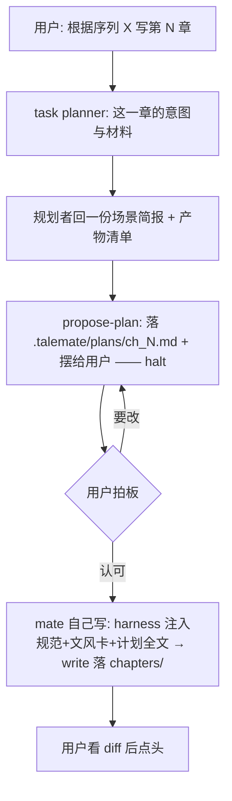

# 设计文档体系：四层活文档与两段式落盘

> **职责**：回答"企划由哪些文档构成、怎么写进去、怎么改、哪些是创作判断、哪些是机器数据"。
> **读者**：要改 `src/framework/design_guides.ts`、`proposal.ts`、`write_ops.ts`、`design_tools.ts` 或设计相关提示词的人。
> **对齐代码**：2026-11-23 · 设计文档不再有必填小节/逐格审阅/形状不变量；指南在 `framework/design_guides.ts`，对象与真源在 `information-model.md`。
> 相邻：`design-guides.md`（角色卡/卷纲/序列等怎么写才算好）· `information-model.md`（对象/真源/载体）· `characters.md` · `outline.md` · `state.md` · `perception.md`

## 一句话

设计文档是**给未来写作的契约**，不是给读者看的简介，也不是一张必须填满的表。我们告诉模型“一份好文档回答什么问题”，不规定它必须长成几张格子。

## 四层

| 层 | 文档 | 变化特征 | 注入方式 |
|---|---|---|---|
| **核心层** | `design/core.md` | 极少变、一改牵全身 | 常驻注入 |
| **世界层** | `design/wiki/world.md` + `design/wiki/<题>.md` | 慢变、追加为主 | 总纲常驻；专题页按需读 |
| **人物层** | `design/characters/<名>.md` | 慢变（合同按卷复核） | 用到谁读谁 |
| **情节层** | `design/outline/vol_<N>.md`（卷）+ `vol_<N>/s<M>.md`（序列） | 快变、最局部 | 当前卷/序列切片 |

**“层”是产品词汇，不是代码类型。** 归属由路径说；没有 `LayerId`、没有按层登记的规范表。

**`state/` 不是第五层。** 它记“现在到哪了”（谁在场、谁知道什么、伏笔收到哪），每章都在变；与 `design/` 平级。判据见 `state.md`。

**没有“整本大纲”。** 主线是什么归核心层的一句话简介；走到哪了由各卷卷纲与状态现算。存一份只会脱节。

## 文档是自由的，指南只给“什么叫好”

`design_guides.ts` 按路径登记每类文档的：

```ts
DesignGuide {
  purpose      // 为什么写它
  questions    // 一份好文档回答什么（不是必填格）
  examples     // 优秀片段
  antiPatterns // 常见烂法
  size         // 尺寸建议
}
```

- **没有必填小节**，也不因为“没按小节组织”拒绝提案。
- **没有形状不变量**（角色卡“必有五格”“不许 `##`”等已删除）。
- **审阅单位是整篇与 diff**，不是“第 N 格”。
- 模型可以用任何结构回答指南的问题；回答得上就是好文档。

机器要用的数据不塞进创作文档：

| 机器需要 | 放哪 |
|---|---|
| 章型 | `task` 入参 / `ask-user` 答案 |
| 承诺状态 | `state/foreshadowing.md` |
| 知识边界 | `state/knowledge`（命题 × 人，提议） |
| 关系 | `state/relations`（提议） |
| 场景边界 | 场景索引（派生） |
| 作者决定 | 事件 + 计算索引 |

## 两种落盘形态

字节从哪来，决定走哪条路：

| | 字节从哪来 | 模型可见工具 | 用户看到什么 |
|---|---|---|---|
| **二向** | 模型当场组合 | `write` · `edit` | 一段 **diff**，确认后落盘 |
| **三向** | 从已审阅的提案取 | `apply-design` | **整篇**（重提看与上一版的 diff），接受/拒绝/提意见 |

两条路汇进同一个 `writeFile`：解析目标 → 读 → 算结果 → 算 diff → 取批准 → CAS + 原子写。

### 三向

- `propose-design` 提交整篇草稿：不写盘、`halt`，本回合结束。
- 用户接受/拒绝/提意见；同意由 harness 判，模型自述无效。
- 接受后 `apply-design` 从提案登记取字节——**模型夹带用户没看过的字是写不出来**。
- 提案只有整篇一种形态；局部修改走二向的 `edit`，用户看精确 diff。
- 文件在提案后被别处改过 → CAS 拒绝落盘。

### 二向

- `edit` 用锚点（或行范围）替换；`write` 整篇写；用户看 diff 确认。
- 改一处不必整篇重提——这是 `edit` 存在的理由。

## 寻址：只有路径

提案与落盘都只收项目相对路径：

```
design/core.md
design/characters/林晚.md
design/outline/vol_1/s2.md
```

没有第二套词表；`layer` 参数已删。读按 `path#section`（有标题时）或整篇/行范围；写按路径 + 锚点。

**两条守卫**（`design_tools.resolveDoc`）：

- 提案只写 `design/` 下的文档；章节正文走 `write` / `edit`。
- 某类主文档不许写到别处（如 `design/world.md` 会被指回 `design/wiki/world.md`），判据来自指南的 `target`。

## 守卫只剩“寻址/安全”

- **重名标题**：如果文档用了标题，新造一个重名会让 `read section` 永远命中前一个 → 拒。
- **路径 / 权限 / CAS / 原子写**：模型不能绕开。
- **没有**“必须有哪几格”“内容必须怎么分节”这类形状校验；创作内容由用户审阅。

## 章节生产



- **一次只规划一章**：章规划是卷契约 + 序列契约的投影。
- **新人物/世界事实排在正文之前**：它们约束正文能做什么；事后补只是对已写正文的总结。
- **门只有一道**：`propose-plan` 交出去就停（`halt`）；同意由 harness 判。
- **规划落 `.talemate/plans`**：引擎工作区，不是作品文档；不进 `DOC_ROOTS`。

## 写作依赖当前版本

每次写正文（以及每次 `task` 委派）都现读当前 core/world/characters/outline/plan 的相关片段，绝不缓存旧设定。感知层负责按 P0–P3 选哪一些（见 `perception.md`）。

## 相关源码

| 文件 | 职责 |
|---|---|
| `framework/design_guides.ts` | 设计指南注册表：purpose / questions / examples / antiPatterns / size |
| `framework/proposal.ts` | 提案视图：整篇 + diff；`proposalOp`（提案 → 写盘 op） |
| `framework/write_ops.ts` | 写盘唯一路径：权限 → CAS → 原子写 → diff |
| `framework/invariants.ts` | 只剩重名标题这一条寻址检查 |
| `framework/characters.ts` | 角色卡路径与名单助手（首句） |
| `framework/plan.ts` | 章规划工件：命名、落盘、渲染 |
| `framework/anchor.ts` | 常驻注入（`RESIDENT_DOCS`）+ `buildIndex` |
| `storage/corpus.ts` | 语料层：枚举/读/扫词的唯一实现 |
| `tool/design_tools.ts` | `propose-design` / `apply-design` 薄壳 |
| `tool/framework_tools.ts` | `design-spec`：按路径取设计指南 |
| `tool/read_tools.ts` | `read` / `list` / `search` |