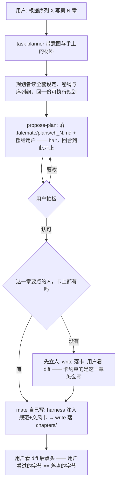

# 设计文档体系：四层活文档，diff 即审阅

> **职责**：回答"企划由哪些文档构成、怎么写进去、怎么改"。
> **读者**：要改 `src/framework/`（assets / write_ops / summaries / anchor）或 `src/tool/file_tools.ts` 的人。
> **对齐代码**：2026-11-26 · 资产四原语 `framework/assets.ts`，语料读写 `storage/corpus.ts`，语料根表 `core/roots.ts`，落盘 `framework/write_ops.ts`（写前 diff + CAS + 原子写）；卷契约/序列契约的读取、世界事实排在正文之前、以及章末的世界层回看由 `prompts/tools/propose-plan.txt` 与 `prompts/planner.system.txt` 的产物清单承载
> 相邻：`assets.md`（每种资产落在哪个文件、什么形状）· `characters.md`（人物层单独一份）· `outline.md`（情节层单独一份）· `state.md`（每章都在变的那一层）· `agents.md`（工具的注册与触发）· `product.md`（产品主流程）

## 四层

设计段的产物是**一组分层、持续迭代、随时可改的活文档**。分层的意义：层间**变化频率、影响范围、再生成范围**不同，维护与注入都按层处理。

| 层 | 文档 | 变化特征 | 注入方式 |
|---|---|---|---|
| **概览层** | `design/brief.md` | 极少变、一改牵全身、用户必须拍板 | 按需 `read`（无文档常驻） |
| **世界层** | `design/wiki/world.md` + `design/wiki/<题>.md` | 慢变、追加为主；长尾拆专题页 | 按需 `read`；`glob` / `grep` 找路径 |
| **人物层** | `design/characters/<名>.md` | 慢变 | 按需读（见 `characters.md`） |
| **情节层** | `design/outline/vol_<N>.md`（卷纲）+ `design/outline/vol_<N>/s<序号>.md`（序列纲） | 快变、最局部 | 按需读（当前卷 / 序列切片） |

**"层"是产品词汇，不是代码里的一个类型。** 它指的是 `design/` 下的四个目录、以及状态卡与 `mate` 对用户说的那四个名字（概览 / 世界观 / 角色 / 大纲）。代码里**没有** `LayerId`、没有按层登记的规范表、也没有 `layer` 参数——文档的归属由**路径**说，别的都不需要。（从前这三样都有，于是"层"这个概念同时当了寻址键、规范匹配键和注入分组；实测下来，只有第一条是多余的。）

## 概览是什么、不是什么

**概览是作品对读者的名片，也是这本书对外的契约。** 它回答的是"读者为什么拿起这本书"：书名、频道、题材、文风，再加一句话简介、基调、读者承诺。`world.md` 写的是**书里**的世界，`brief.md` 写的是**书外**的那个人凭什么走进来——这是四层里唯一朝外的一份。

**概览不是内容摘要。** 凡是从世界观、人物、大纲能推导出来的东西，都不进概览：情节走向、势力关系、角色结局抄一份过来，第二天那边一改就说两套话。判据很硬——**删掉概览，世界观 / 人物 / 大纲仍然完整；删掉 world，书就写不下去。** 概览回答"这本书是什么"，不回答"书里发生了什么"。

**概览同时是一张配置卡。** 频道、题材、文风有机器消费者（书架、状态栏的文风选择器、正文写作窗口、状态卡），所以它们住在 frontmatter 的 `title` / `channel` / `genre` 字段；正文留给人写。文风暂留在 `## 文风` 小节——文风那条链会整体重构，在那之前它是唯一的地方，别在 frontmatter 里再添一份。

**它是可选的，不是门槛。** 没有 `brief.md` 也能写正文；`createProject` 只在用户建书时选过频道 / 题材时种下 frontmatter（`withShelf`），其余一个字不写。

**没有文档常驻注入。** `design/brief.md` 与 `design/wiki/world.md` 从前每轮进 system，现在和别的文档一样：模型要 `read` 才拿到内容，而读到的就是读它的那一刻的版本。`anchor.RESIDENT_DOCS` 与相关注入已删除——留在 system 里只是一份会过期的副本，还让模型不知道自己没读过它。

**`state/` 不是第五层。** 它记的是"现在到哪了"（谁在场、谁知道什么、伏笔收到哪了），每章都在变——比变化最快的情节层还快一个数量级。所以它在项目根下与 `design/` **平级**，与设定分开。判据与形状见 `state.md`。

**文档格式**：Markdown，`##` 即一格。**读**按"**项目相对路径** + 小节标题"寻址（`read` 的 `path` 与 `section`）；**写**按**锚点**寻址（`edit` 给一段原文与替换文本，见"落盘只有一条路"）。不做条目级 ID 引用。

**全仓只有一种路径口径**：项目相对（`design/brief.md` / `chapters/chapter_ch2_v1.md`）——工具入参、`FileOp.path`、权限 pattern、`invariants` 的匹配键，全是它。

## 懒建：文件不预种

`createProject` 只建目录、不种文件——`design/` 初始为空。用户要写哪一层就直接 `write`；格式建议在 `assets/kinds/*.json`，只是参考。

**一处例外**：桌面端建书时会把用户在书架上选的频道与题材种进 `design/brief.md` 的 frontmatter（`withShelf`）——值是用户从封闭集合里挑的，没有可生成的东西，与文风选择器同一类。它**只种这一次**：此后那两格归企划管，在书架上改题材不会回头改它。CLI 建的书仍是空的。

**规范是建议，不是通行证。** 旧的结构规范表与规范查询已删：一份文档该长什么样，模型从用户意图与同类文档里读得出来；而规范表一旦存在就会被当成校验器——用户没要求的小节成了门槛，写得再好也"不合格"。留下的是**可推导**的那部分：`framework/assetkinds.ts` 读 `assets/kinds/*.json`，只回答"这种文件是什么、通常放哪"，不规定每一格必须有什么。载体约定见 `assets.md`。

## 落盘只有一条路

> **用户看过的字节 == 落盘的字节。** 这件事靠**用户看的是 diff** 保证，不靠另一份登记。

`write` / `edit` / `delete` 都不自己落盘——拼出 `FileOp` 交给 `framework/write_ops.ts`：解析目标 → 读 → 算结果 → 算 diff → 取批准 → CAS + 原子写。

- **整篇写** = `write` 的 diff：新建是整篇新增，覆盖是逐行差异。用户点接受才落地。
- **局部改** = `edit` 的 diff：只给原文片段与替换文本，其余字节原样。
- **并发保护**：写前重新读目标；若文件在"算 diff"之后被别处改过，整次拒绝（CAS），不覆盖别人的修改。
- **删除**：`delete` 先做**整个项目**的引用检查（正文里也会提到角色与设定名，走 `corpus.scanDocs`），命中结果列进审批说明——**级联清理由模型自己用 `edit` 逐处做**，工具只负责把影响面摆出来。
- **不变量后验**：写完与写前预览都跑 `framework/invariants.ts`，拦住会让文档读不懂的改动。

**两段式提案已经删掉**（提案 → 用户回话 → 落盘）。它原本要解决"模型夹带用户没看过的字节"；但那件事 diff 预览本来就解决了，多出来的一层只买到"再读一遍全文"，还带来一套提案登记、`base` 快照与草稿模式。现在**没有提案、没有草稿模式**：整篇成稿是普通 `write`，用户照样在弹窗上点头。

## 寻址：只有路径

所有工具只收一个 `path`：**项目相对路径**（`design/brief.md`、`design/characters/林晚.md`、`design/outline/vol_1/s2.md`）。没有第二套词表。

```
write          { path: "design/wiki/world.md", content: "…" }
edit           { path: "design/characters/林晚.md", find: "…", replace: "…" }
read           { path: "chapters/chapter_ch2_v1.md" }
```

**曾经有一个 `layer` 参数**（`core | world | …`），当的是"少拼一次路径"的糖。它被删掉的理由：糖能表达的路径本来就能表达，而它多带一套词表——于是同一个"世界层在哪"在代码里有两处定义（一份只装四个短名的表，与另一份按 glob 匹配的路径表），模型也见过两种地址形式。路径口径统一之后，那份间接只剩成本。

**能写哪些目录由项目根表划**（`talemate.json.corpusRoots`），不是由工具名划。写错位置的代价是**读不到**（`read` / `glob` 按根表枚举），没有工具会在落盘时替模型纠正路径——约定的载体见 `assets.md`。

## 文档级的守卫

- **重名小节**：寻址按标题，两个同名 `##` 之后"读第 2 节"永远命中前一个——此后工具读不懂这份文档。`framework/invariants.ts` 的 `design.no-duplicate-heading` 拦"**新造出来**"的重名（新文件里出现两个同名小节也算）。
- **删除**：见上节——引用清单进审批说明，级联由模型逐处判断。
- **角色卡没有专用规则**：骨架与常见格都是建议，不拦落盘；名单每次现算，数据源只有卡本身。见 `characters.md`。

## 章节生产



**一次只规划一章**，因为规划是**卷契约 + 序列契约的投影**：序列契约说"这一小段必须让什么为真"，卷契约给出它的边界（独立问题、旧债/新债、禁揭、本卷上限），规划说"这一章怎么让它为真"。

**新人物的卡排在正文之前**（图里的 `W4B`）。卡的用途是约束"他下一次怎么说话、什么绝不做"，事后从正文反推出来的卡只能是对已写正文的总结——那是墓志铭，不是合同。所以建卡排在正文之前，但**它只是一次 `write`**（用户看 diff 点头），不是另一条流程：建卡是设计动作，不是写作动作，它只是被章节生产**触发**的。判据见 `characters.md` 的“谁需要一张卡”。

**同一条测试也管世界事实**：一条规则、一个术语的含义、一条能力边界，同样"约束正文能做什么"，所以同样排在正文之前，同样是一次 `write`；事后补就只能是对已写正文的总结。**纯起名不算**——一个地方只需要有个称呼，在规划里定下就行。章末另有一次**世界层回看**：正文与“规则与秩序”“术语表”冲突的报给用户裁决（绝不静默改设定），把原本（待定）的钉死或揭开了某条硬事实的则提议改那一格。见 `chapter-planning.md` 的“七”。

**门只剩一道，挂在 `propose-plan` 上：交出去就停**（`halt`，不靠模型自觉）。它同时把规划登记进会话内存，用户回话后由 harness 置 `approved`——登记与判定都在 harness，模型只负责按已批准的规划执行。

**从前还有第二道门**（`task(writer)` 查那份 `approved`，没拍板就不放行）。它随 writer 一起取消了：正文改由 mate 自己写，而"写正文"是普通 `write`——用户照样在 diff 上点头，再挂一道门只是把同一件事问两遍。

**规划落盘**，落在 `<novel>/.talemate/plans/ch_<N>.md`——**引擎的工作区，不是 `design/`**。`design/` + `chapters/` 是作品（用户的、要被审阅的、可进版本控制的），`.talemate/` 是这一次执行的状态：可清理、用户不必看、不参与 `glob` / `grep` / 不变量。所以它**不走 `write_ops`**（那条路认识的是作品文档：diff、CAS、权限 pattern）——由 `propose-plan` 自己整篇写、整篇渲染出来，用户看过的字节就是落盘的字节。命名与清理策略见 `framework/plan.ts`。

**mate 没有阶段状态机**："设计段/写作段"不是代码里的状态，而是**用户点名驱动**——说"完善概览"就走企划成型，说"写第 N 章"就走章节生产。

## 写作依赖当前版本

每次写正文（以及每次 `task` 委派），都**现读**"当前 core 切片 + 相关 world/characters 切片 + 卷纲相关格 + 序列纲/规划"——**绝不缓存旧设定**。

## 相关源码

| 文件 | 职责 |
|---|---|
| `storage/corpus.ts` | **语料层**：枚举 / 读 / 扫词的唯一实现（项目相对口径、项目根表、一条 walker）。只读，没有任何写口 |
| `framework/summaries.ts` | 目录摘要器注册表：**某种文档在目录索引里占哪一行**（角色卡一人一行、不分格的给首句）。形状照抄 `invariants` |
| `framework/search.ts` | 扫词命中的**渲染**（`renderHits`：按文件分组 + 小节标注）。取数在 `corpus` |
| `framework/write_ops.ts` | **写盘唯一路径**：解析目标 → 读 → 算结果 → diff → 取批准 → CAS + 原子写 |
| `framework/file_ops.ts` | `FileOp` → 新内容（纯函数）：整篇 / 锚点替换 / 删除**三种**。行尾适配在这一层 |
| `framework/match.ts` | 锚点匹配的回退阶梯（唯一性、跨度失控兜底） |
| `framework/invariants.ts` | **对算出来的结果做后验**（重名小节一条）。写前预览与写后都跑同一份 |
| `framework/plan.ts` | **章节规划工件**：命名（`.talemate/plans/ch_<N>.md`）、落盘、终端渲染（`renderPlan`）与卡片视图（`planDisplay`）。**不走 `write_ops`**——它不是作品文档，见本文件“章节生产” |
| `framework/markdown.ts` | 区块**读**手术（`getSection` / `removeSection` / `listHeadings`）。改一格不再走这里——见 `edit` |
| `framework/anchor.ts` | 目录索引（`buildIndex` / `docTree`，`read` 找不到文档时的清单与左栏的那一份）。**没有常驻注入** |
| `tool/read_tools.ts` | `read` 一个薄壳（**项目级**，与 design 无关） |
| `tool/find_tools.ts` | `glob` / `grep` 两个找法，候选集来自语料根表 |
